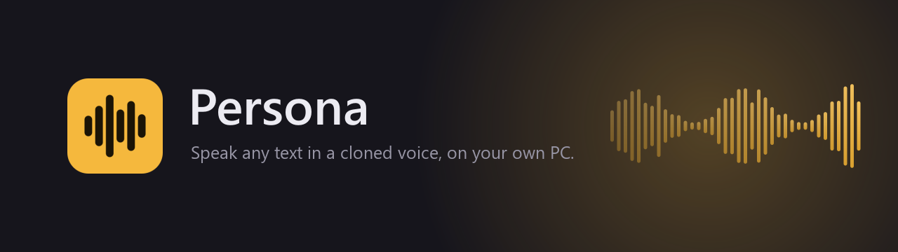
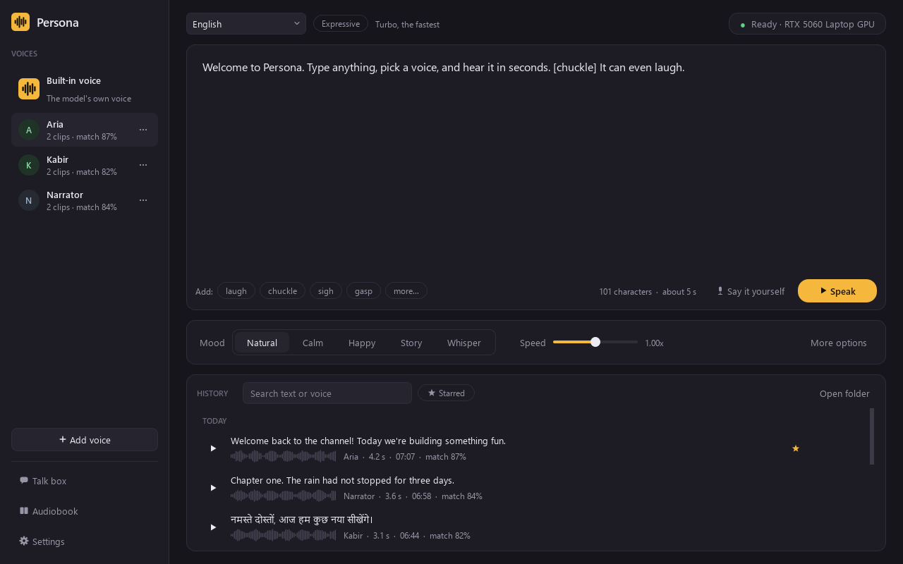
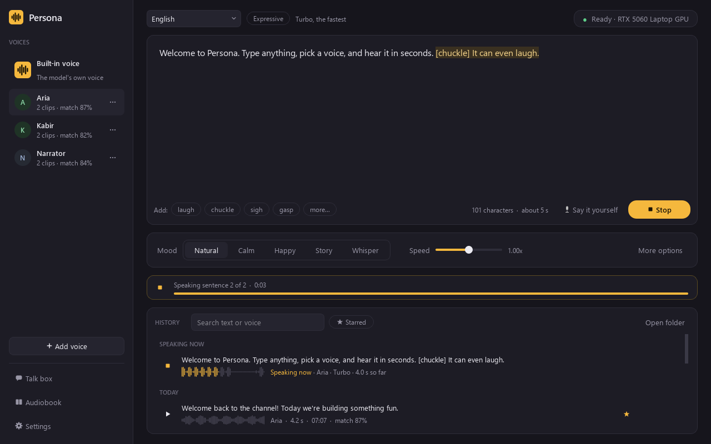
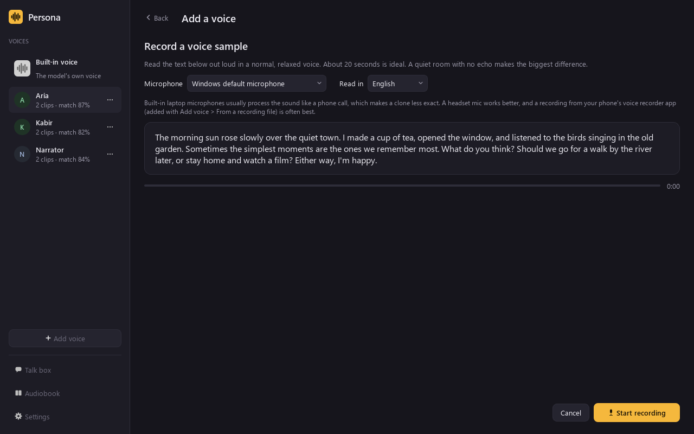
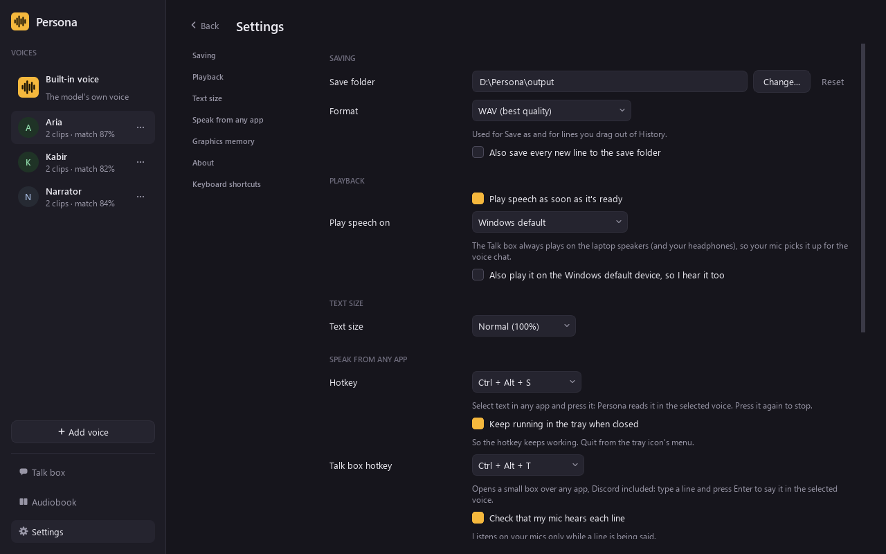
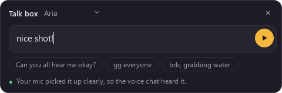
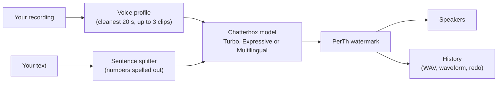

  

  
  
  
  

<h3 align="center">Clone a voice from 20 seconds of audio. Type anything. Hear it back in that voice.</h3>

  No cloud, no account, no subscription. Persona runs the open Chatterbox voice models on your own graphics card, 
  and on an RTX card the first word plays in about half a second.

  <a href="#-get-started">Get started</a> &nbsp;&bull;&nbsp;
  <a href="#-what-it-does">Features</a> &nbsp;&bull;&nbsp;
  <a href="#-how-it-works">How it works</a> &nbsp;&bull;&nbsp;
  <a href="#-questions">Questions</a>

 

  

 

## &#9670; What it does

<table>
  <tr>
    <td width="50%" valign="top">
      <h4>Clone a voice in a minute</h4>
      Record yourself reading a short passage, or drop in any recording: a voice note, a video, a podcast clip.
      Persona finds the cleanest 20 seconds, warns you about phone-call-quality mics, and saves the voice.
      Add up to three clips for a steadier clone.
    </td>
    <td width="50%" valign="top">
      <h4>Speak instantly</h4>
      Type and press <kbd>Ctrl</kbd>+<kbd>Enter</kbd>. Long text is split into sentences and streamed, so
      playback starts almost at once, and the sentence being spoken lights up as you hear it.
    </td>
  </tr>
  <tr>
    <td valign="top">
      <h4>Moods and little sounds</h4>
      Natural, Calm, Happy, Storytelling and Whisper moods, a speed slider, and sound tags like
      <code>[laugh]</code>, <code>[chuckle]</code>, <code>[sigh]</code> and <code>[gasp]</code> right inside your text.
    </td>
    <td valign="top">
      <h4>23 languages</h4>
      English on the fast Turbo model or the Expressive one (emotion and pace controls). Hindi, Japanese, Arabic,
      French, Spanish and 17 more on the Multilingual model, with numbers spelled out properly, Indian
      lakh and crore included.
    </td>
  </tr>
  <tr>
    <td valign="top">
      <h4>Speak from any app</h4>
      Select text anywhere (a browser, a PDF, a chat) and press <kbd>Ctrl</kbd>+<kbd>Alt</kbd>+<kbd>S</kbd>.
      Persona reads it in your voice from the system tray, then puts your clipboard back as it was.
    </td>
    <td valign="top">
      <h4>Talk box for voice chats</h4>
      <kbd>Ctrl</kbd>+<kbd>Alt</kbd>+<kbd>T</kbd> pops up a small box over Discord or a game. Type a line,
      press Enter, and it's said in your cloned voice through your speakers, so your mic carries it into the call.
    </td>
  </tr>
  <tr>
    <td valign="top">
      <h4>Say it yourself</h4>
      Record a line in your own voice and Persona re-voices it, keeping your exact timing and emotion.
      Speech to speech, with no extra download.
    </td>
    <td valign="top">
      <h4>Audiobooks</h4>
      Turn a <code>.txt</code>, <code>.docx</code> or <code>.pdf</code> into one MP3 with chapter markers and
      subtitles. Pause any time, even close Persona, and carry on later from the same sentence.
    </td>
  </tr>
  <tr>
    <td valign="top">
      <h4>A History worth keeping</h4>
      Every line is saved with its waveform. Click to seek, star the best takes, search, drag a line straight
      into a chat to share it, or redo just one sentence of it without remaking the rest.
    </td>
    <td valign="top">
      <h4>Private by design</h4>
      Voices are made and spoken on your PC. The only connection is the one-time model download from
      Resemble AI's official page on Hugging Face. Delete the folder and Persona is gone.
    </td>
  </tr>
</table>

 

## &#9670; A closer look

<table>
  <tr>
    <td width="50%" align="center" valign="top">
       
      <b>Speaking.</b> The sentence you're hearing is highlighted, and History shows it as it's made.
    </td>
    <td width="50%" align="center" valign="top">
       
      <b>Adding a voice.</b> Read the passage aloud, in English or Hindi, or use a recording file.
    </td>
  </tr>
  <tr>
    <td align="center" valign="top">
       
      <b>Settings.</b> Everything opens inside the window: no pop-ups.
    </td>
    <td align="center" valign="middle">
       
      <b>The Talk box.</b> Floats over any app, remembers your last lines, and checks your mic heard each one.
    </td>
  </tr>
</table>

 

## &#9670; How it works

Persona is a desktop app written in Python with Qt (PySide6). The voice work happens on its own thread, so the
window never freezes, and each sentence is played the moment it's ready rather than after the whole text.

 

## &#9670; Get started

### What you need

| | |
|---|---|
| **System** | Windows 10 or 11, 64-bit |
| **Graphics card** | NVIDIA GTX 10-series or newer with about 4 GB of memory and a recent driver. RTX recommended. Without one, Persona runs on the processor, much more slowly. |
| **Memory** | 16 GB of RAM recommended |
| **Disk** | About 6 GB for Python and the packages, plus about 3 GB for each voice model |
| **Internet** | Once, to download the packages and the voice model |

## &#9670; Using Persona

1. **Add a voice.** Click **Add voice**, then record yourself or pick a recording. You can also drop an audio or
   video file anywhere on the window.
2. **Type** what it should say, pick a mood, and press **Speak**.
3. **Keep the best takes.** Star them in History, export them as WAV or MP3, or drag them into a chat.

**For the closest clone:** record about 20 seconds in a quiet room with no echo. A phone's voice recorder usually
beats a laptop's built-in mic, which often processes your voice like a phone call (Persona tells you when it
hears that). Turn on **Closest match** under More options to make three takes of every sentence and keep the one
that sounds most like the voice.

### Keyboard shortcuts

| Keys | What they do |
|---|---|
| <kbd>Ctrl</kbd> + <kbd>Enter</kbd> | Speak, or stop |
| <kbd>Esc</kbd> | Stop, or go back from a page |
| <kbd>Ctrl</kbd> + <kbd>T</kbd> | Open the Talk box |
| <kbd>Ctrl</kbd> + <kbd>,</kbd> | Open Settings |
| <kbd>F1</kbd> | Show all shortcuts |
| <kbd>Ctrl</kbd> + <kbd>Alt</kbd> + <kbd>S</kbd> | Speak the selected text in any app |
| <kbd>Ctrl</kbd> + <kbd>Alt</kbd> + <kbd>T</kbd> | Open the Talk box from any app |

The two global hotkeys can be changed in Settings if another app already uses them.

 

## &#9670; Questions

<b>Will it run on my PC?</b>

 

Almost certainly. Persona picks the fastest thing your PC has: the graphics card if it's a supported NVIDIA one,
otherwise the processor. Nothing to set up either way.

| Your PC | Where Persona runs | What to expect |
|---|---|---|
| **NVIDIA RTX 20, 30, 40 or 50-series** (tested on RTX 4050 and RTX 5060) | Graphics card | Speech starts in about half a second and is made faster than you can listen to it |
| **NVIDIA GTX 10 or 16-series** | Graphics card | Works well; a little slower than RTX |
| **Older NVIDIA, AMD or Intel graphics, or none** | Processor | Works, but slower: a few seconds before the first word, and long text takes a while |

A few things help:

- **4 GB of graphics memory** is enough for the voice model. Close games before a long session, or let Persona
  free the memory by itself after 10 minutes of quiet.
- **Keep the NVIDIA driver up to date.** Persona's PyTorch uses CUDA 12.8, which needs a driver from 2025 or later.
- **On the processor, more cores is better.** Even a fast 16-core laptop processor makes speech at about two thirds
  of real time, so short lines feel fine and long ones need a little patience. 16 GB of RAM is recommended.

<b>Is my voice uploaded anywhere?</b>

 
No. Recordings, voices, History and settings stay in Persona's folder on your PC. The only thing Persona ever
downloads is the voice model, once, from <a href="https://huggingface.co/ResembleAI">huggingface.co/ResembleAI</a>.

<b>Where does Persona keep my things?</b>

 
Everything it saves (settings, voices, History, audiobooks, models and logs) stays inside its own folder, so
deleting the folder removes it all. If that folder can't be written to, it uses <code>%LOCALAPPDATA%\Persona</code>
instead. Set the <code>PERSONA_DATA</code> environment variable to choose another place.

<b>It takes a while to load. Is that normal?</b>

 
Loading the model takes a few seconds on a graphics card. After 10 minutes without use, Persona unloads it to
free about 3 GB of graphics memory for games (you can change or turn this off in Settings). The next Speak
loads it again.

<b>Does it run on Linux?</b>

 
The main window, voices, speaking, History and audiobooks are written to work on Linux too, with FFmpeg and
PortAudio installed from your distribution. The global hotkeys, tray icon and shortcuts are Windows features.
Persona is built and tested on Windows first.

<b>Can I tell that audio was made with Persona?</b>

 
Yes. Everything Persona makes carries Resemble AI's inaudible PerTh watermark, which marks it as AI-generated.

 

## &#9670; Use voices responsibly

Only clone voices you have permission to use: your own, or someone who has agreed. Pretending to be a real person
can hurt people and may be against the law where you live.

 

## &#9670; Built with

[Chatterbox](https://github.com/resemble-ai/chatterbox) by Resemble AI for the voices &nbsp;&bull;&nbsp;
[PyTorch](https://pytorch.org) &nbsp;&bull;&nbsp; [Qt for Python](https://doc.qt.io/qtforpython-6/) &nbsp;&bull;&nbsp;
[FFmpeg](https://ffmpeg.org) &nbsp;&bull;&nbsp; [sounddevice](https://python-sounddevice.readthedocs.io)

 

